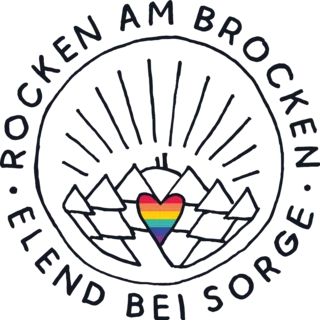
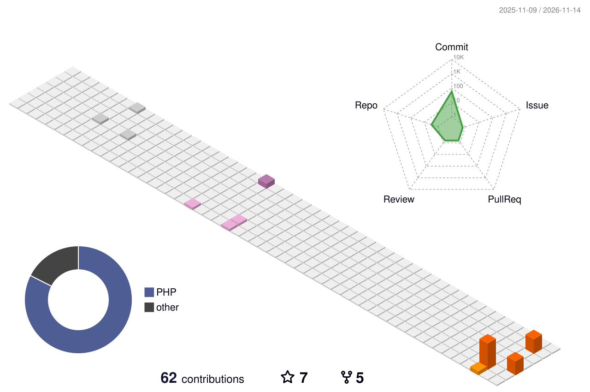

📍 Chemnitz · Harz · Berlin · Remote

### Hi there 

I build the tech behind festivals: software, servers and Wi-Fi across entire festival sites.
Organizing events since 2007, writing code professionally since 2013, making music since I was five.

### ⛰️ Rocken am Brocken

<picture>
  <source media="(prefers-color-scheme: dark)" srcset="assets/rocken-am-brocken-dark.png">
  
</picture>

My heart project since 2012: **[Rocken am Brocken](https://brocken.rocks)**, three days of music and nature in Elend near Sorge, right in the Upper Harz.
Down-to-earth, diverse and for everyone.

As **CTO & part of the production team** I take care of the tech: software, servers and Wi-Fi across the whole festival site.

**Next edition: 29–31 July 2027** · [brocken.rocks](https://brocken.rocks)

 

### 🎪 What I'm doing

- **Partner & CTO** at [LDE Solutions](https://lde-solutions.com) (since 2025)
- **Head of IT Services & CTO** at [Höme – für Festivals](https://hoemepage.com) (since 2021)
- **CTO & Production** at [Rocken am Brocken](https://brocken.rocks) (since 2012)
- Previously **Senior Developer & Data Protection Officer** at [DMK E-Business](https://www.dmk-ebusiness.de/) (2013–2021)

### 🧰 What I work with

Focus: API design & design patterns.

### 📈 Contributions

<picture>
  <source media="(prefers-color-scheme: dark)" srcset="./profile-3d-contrib/profile-night-rainbow.svg">
  
</picture>

### 📦 Open source

| Package | What it does | Downloads |
| --- | --- | --- |
| [OroBasicsBundle](https://github.com/RocKordier/OroBasicsBundle) | Basic configuration, helpers and tools for Oro applications |  |
| [OroCRMBasicsBundle](https://github.com/RocKordier/OroCRMBasicsBundle) | Basic configuration, helpers and tools for OroCRM |  |
| [CIUtility](https://github.com/RocKordier/CIUtility) | Utilities and scripts for CI (testing, PHPCS …) |  |
| [Anonymizer](https://github.com/PHPSharkTank/Anonymizer) | Library to anonymize class properties |  |
| [AnonymizerBundle](https://github.com/PHPSharkTank/AnonymizerBundle) | Symfony integration for the Anonymizer component |  |

### 🏢 Organizations

### 🎸 Backstage at

[Rocken am Brocken](https://brocken.rocks) ·
[Feel Festival](https://feel-festival.de) ·
[Moyn Festival](https://moynfestival.de) ·
[Summertime Festival](https://summertimefestival.de) ·
[Puls Open Air](https://pulsopenair.de) ·
[Festival Playground](https://www.festivalplayground.com) · and many more

Off stage: musicals, yoga, skiing, a Prusa CORE One that's always printing something, and Zelda / The Witcher / Assassin's Creed.

